# 💸 Expense Tracker App

> Turn a raw, messy 12-month expense ledger into a decision-ready story — clean it, track every category against budget, quantify savings and spending patterns, catch the user-days that actually broke the pattern, and present it all through a CLI pipeline, 10 charts and a 5-tab interactive Streamlit dashboard.

**Stack:** Python · Pandas · NumPy · Matplotlib · Seaborn · Plotly · Streamlit · Pytest

**Author:** [Harsha K S](https://github.com/harshaks17-ai)

---

## 1. Overview

Most people who "track expenses" end up with a spreadsheet full of `Rs. 1,299`, `1,299`, `₹1299`, three date formats, duplicate exports, blank categories and a few outliers that quietly destroy every average. The file exists, but it answers nothing: *Is this month normal? Which category is actually the problem? How much can I really save?*

**Expense Tracker App** is a complete, tested pipeline that answers those questions from a single CSV:

```
raw CSV  ──►  clean  ──►  aggregate  ──►  visualise  ──►  insight report  ──►  dashboard
```

The dataset bundled with this project is **synthetic** — 50 users × 12 months (2025-10-01 → 2026-09-30) with realistic income, per-category budgets, festival spikes, weekend behaviour and merchant choices — deliberately polluted with the defects above, so every stage of the pipeline has real work to do.

### Features

| | |
| --- | --- |
| 🧹 **Cleaning** | dedupe (twice), `Rs.`/comma text amounts, three date formats, category casing, blank/zero/negative/outlier rows, out-of-window dates |
| 📐 **Statistics** | category share %, Pareto cut, per-user budget variance, month-over-month trend, savings rate, weekend lift vs baseline |
| 💰 **Budgeting** | 10 categories with real per-user monthly budgets, over/under status and the rupee gap per user |
| 👥 **Segmentation** | heavy / moderate / light spender archetypes and what share of spend each one carries |
| 🚨 **Anomaly detection** | **per-user** robust z-score (median / MAD) over *discretionary* spend — 657 flagged user-days at ~1.1 alerts per user per month |
| 🏪 **Merchant analysis** | top merchants by value *and* by visit frequency, inside every category |
| 📊 **Charts** | 10 saved PNGs: category bars, monthly trend, budget vs actual, donut, payment mix, weekday × time heatmap, merchants, savings, anomaly timeline, segment composition |
| 🖥️ **Dashboard** | 5-tab Streamlit light-mode report UI: flat KPI row, sidebar filters, CSV upload |
| 📝 **Reports** | machine-readable `analysis_summary.json` + human insight report + data-quality report |
| ✅ **Tests** | 30 automated tests: 27 pipeline, 2 headless Streamlit (AppTest) + a **real-browser end-to-end test** (Playwright) that clicks every tab, filters and uploads a CSV |
| ♻️ **Your own data** | upload any expense CSV and the same pipeline runs on it |

---

## 2. Problem → Solution

**Problem.** An expense ledger is a record, not an analysis. Cleaning it by hand is a one-time effort that is out of date the moment a new export lands, and the questions a user actually asks — *am I over budget, where, and by how much?* — are never in the file.

**Solution.** A five-stage pipeline that measures the data-quality problem, fixes it, quantifies it with statistics, detects the individual days that broke the pattern, and presents the result three ways (charts, report, dashboard) — reproducible with one command.

```
┌────────────────────┐   ┌──────────────────┐   ┌─────────────────┐   ┌────────────────┐
│  SYNTHETIC / CSV   │   │     CLEANING     │   │    ANALYSIS     │   │  VISUALISATION │
│                    │   │                  │   │                 │   │                │
│  user_id           │──►│ dedupe (x2)      │──►│ category share  │──►│ 10 PNG charts  │
│  date / amount     │   │ parse Rs. text   │   │ Pareto cut      │   │                │
│  category          │   │ parse 3 date fmts│   │ budget variance │   │ INSIGHTS       │
│  merchant          │   │ canonicalise cat │   │ MoM trend       │   │ Markdown report│
│  payment_method    │   │ drop blanks/neg  │   │ savings rate    │   │                │
│  income            │   │ drop > 100k      │   │ per-user z-score│   │                │
└────────────────────┘   └──────────────────┘   └─────────────────┘   └────────────────┘
        ▲                                                                       │
        └─────────────────── Streamlit dashboard (upload / filter) ◄────────────┘
```

---

## 3. Tech stack

| Layer | Choice | Why |
| --- | --- | --- |
| Language | Python 3.10+ | standard for data analysis |
| Data wrangling | Pandas + NumPy | group-bys, resampling, vectorised sampling and robust statistics |
| Static charts | Matplotlib + Seaborn | reproducible, version-controlled PNGs |
| Interactive charts | Plotly | hover, zoom and faceted subplots in the dashboard |
| Dashboard | Streamlit | one file, pure Python, no HTML/JS |
| Robust stats | median + MAD (hand-rolled) | outlier-resistant detection **without** pulling in SciPy |
| Tests | Pytest-compatible (runs standalone too) | every stage verifiable with `python tests/test_pipeline.py` |

---

## 4. Quick start

```bash
# 1. clone and enter the project
git clone https://github.com/harshaks17-ai/Expense-Tracker-App.git
cd Expense-Tracker-App

# 2. create and activate a virtual environment
python -m venv .venv
# Windows
.venv\Scripts\activate
# macOS / Linux
source .venv/bin/activate

# 3. install dependencies
pip install -r requirements.txt

# 4. run the whole pipeline (generate -> clean -> analyse -> 10 charts -> insights)
python main.py all

# 5. launch the dashboard
python main.py dashboard        # or: streamlit run dashboard.py
```

Then open the URL Streamlit prints (usually <http://localhost:8501>).

### Command reference

| Command | What it does |
| --- | --- |
| `python main.py all` | full pipeline, prints headline numbers to the console |
| `python main.py generate` | create/overwrite the raw synthetic ledger + income |
| `python main.py clean` | clean the raw export → `data/processed/expenses_clean.csv` |
| `python main.py analyze` | statistics → `outputs/reports/analysis_summary.json` |
| `python main.py visualize` | render all 10 charts → `outputs/charts/` |
| `python main.py insights` | write `outputs/reports/insights_report.md` + `summary_in_thousands.csv` |
| `python main.py dashboard` | start the Streamlit dashboard |
| `python tests/test_pipeline.py` | run the 27 pipeline tests |
| `python tests/test_dashboard.py` | headless dashboard smoke test (AppTest) |
| `python tests/test_browser.py` | full browser test — starts the server, clicks every tab, filters, uploads a CSV, then stops it |
| `python -m pytest tests/ -q` | run all 30 tests |

---

## 5. Project structure

```
Expense-Tracker-App/
│
├── data/
│   ├── raw/                     # the "as exported" ledger + income (intentionally dirty)
│   └── processed/               # the cleaned, analysis-ready dataset
│
├── notebooks/
│   └── Expense_Tracker_EDA.ipynb  # step-by-step EDA with explanations
│
├── src/
│   ├── config.py                # paths, palette, budgets, merchants, noise rates
│   ├── utils.py                 # folders, logging, theming, money formatting
│   ├── data_generator.py        # 50 users x 12 months + realistic behaviour + dirt
│   ├── data_cleaning.py         # the cleaning pipeline + data-quality report
│   ├── analysis.py              # budgets, Pareto, trends, segments, per-user anomalies
│   ├── visualization.py         # 10 matplotlib/seaborn charts
│   └── insights.py              # Markdown insight report
│
├── outputs/
│   ├── charts/                  # 10 PNG charts
│   └── reports/                 # insights_report.md, analysis_summary.json, data_quality_report.md,
│                                # summary_in_thousands.csv (every amount ÷ 1,000)
│
├── images/                      # screenshots used in this README
├── tests/                       # pipeline tests + dashboard smoke test + browser test
├── dashboard.py                 # Streamlit app
├── main.py                      # CLI entry point
├── requirements.txt
├── LICENSE
└── README.md
```

---

## 6. Results

The bundled run (seed 42, 50 users, 12 months, ₹ INR):

```
Raw rows ............ 17,176      Duplicates removed ... 183 + 36 (post-normalisation)
Valid transactions .. 16,179      Retention ............ 94.20%
Users ............... 50          Categories ........... 10
```

**Headline: ₹37,263,112 spent across 16,179 transactions** — ₹62,105 per user per month against a ₹53,500 budget, with an overall savings rate of **+10.0%**.

| Rank | Category | Spend | Share | Budget / user | Variance | Status |
| ---: | --- | ---: | ---: | ---: | ---: | :--- |
| 1 | Rent & Utilities | ₹10,326,927 | 27.7% | ₹18,000 | −4.4% | On track |
| 2 | Travel | ₹5,538,535 | 14.9% | ₹5,000 | **+84.6%** | Over budget |
| 3 | Food & Dining | ₹5,472,478 | 14.7% | ₹8,000 | +14.0% | Over budget |
| 4 | Shopping | ₹4,098,347 | 11.0% | ₹6,000 | +13.8% | Over budget |
| 5 | Groceries | ₹3,377,844 | 9.1% | ₹5,000 | +12.6% | Over budget |
| 6 | Transport | ₹2,631,101 | 7.1% | ₹4,000 | +9.6% | Over budget |
| 7 | Education | ₹1,751,803 | 4.7% | ₹1,500 | **+94.6%** | Over budget |
| 8 | Entertainment | ₹1,633,476 | 4.4% | ₹2,500 | +8.9% | Over budget |
| 9 | Health | ₹1,380,419 | 3.7% | ₹2,000 | +15.0% | Over budget |
| 10 | Miscellaneous | ₹1,052,182 | 2.8% | ₹1,500 | +16.9% | Over budget |

**Insights the pipeline produces automatically**

- **Five categories carry 77.3% of every rupee spent** — Rent & Utilities, Travel, Food & Dining, Shopping, Groceries. A budget review should start there and nowhere else.
- **Education (+94.6%) and Travel (+84.6%) are the two real problems.** Food, Shopping and Groceries being 12–14% over is a rounding problem by comparison, yet they are the categories people instinctively try to cut.
- **The 30-day burn rate is ₹44,279 per user — 124.7% of the ₹35,500 variable budget.** Recurring bills are excluded from that figure on purpose, so this is genuinely discretionary money leaving ~25% faster than planned.
- **Two festival months wreck the savings rate.** 2026-03 and 2025-11 cost ~36% and ~23% more than a normal month, and are the only two months with a **negative** savings rate (−15.9% and −9.7%). The best month, 2026-05, saves +20.3%.
- **9 of 50 users (18%) generate 37.5% of all spend** — heavy spenders average ₹1,550,728/year against ₹345,327 for light spenders, a 4.5× gap.
- **657 abnormal user-days across 46 users** (~1.1 per user per month). The most extreme: a user whose normal day is ₹3,507 spent ₹54,773 across 8 transactions.
- **Weekends carry 32.9% of spend against a 28.6% baseline** (+15.2% lift), and the busiest bucket is Midday (10–14) — behaviour the budget never accounted for.
- **UPI is the payment rail** at 41.9% of value; **Airbnb (₹1.23M) and IRCTC (₹1.21M) are the top merchants**, while food delivery is a frequency story — Zomato, Swiggy, Dominos, Starbucks and Local Cafe together take 5,259 orders.

---

## 7. Screenshots

| | |
| --- | --- |
| 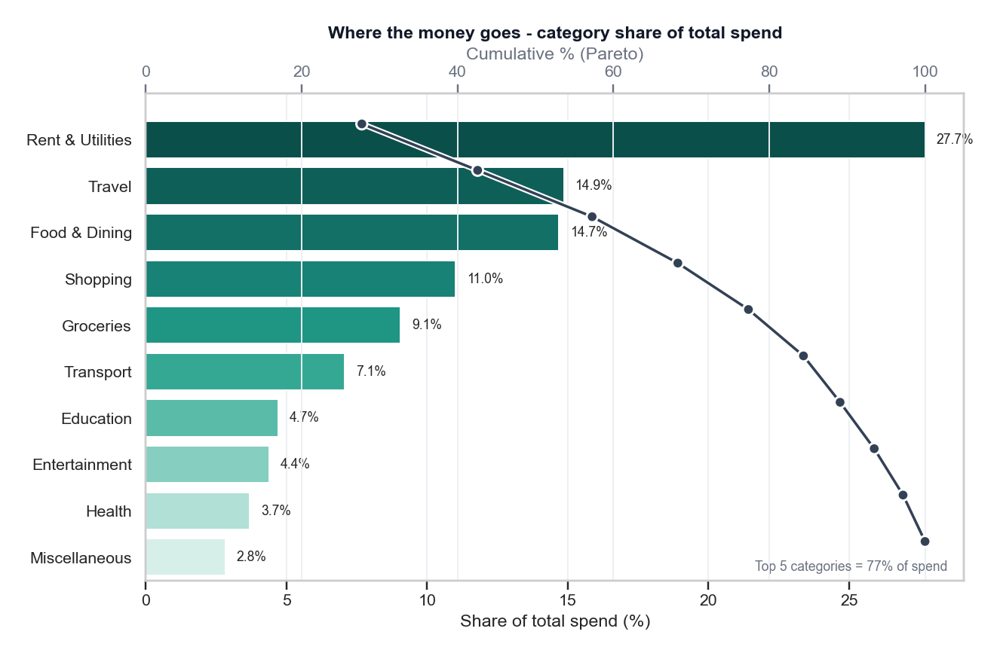 | 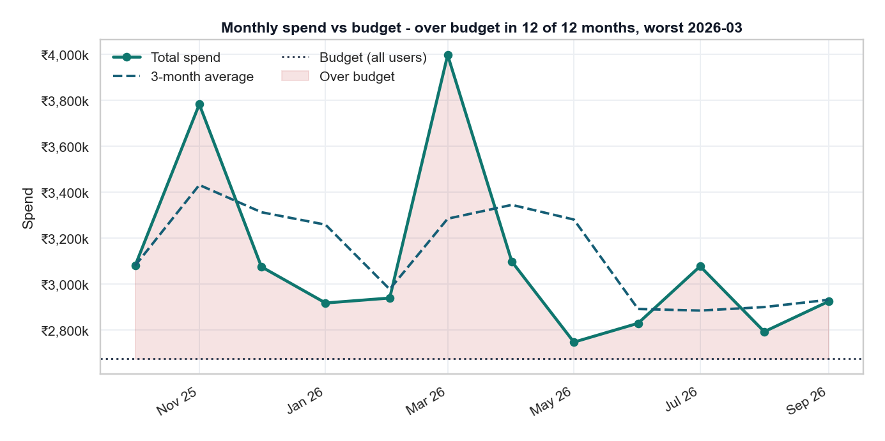 |
| **Category share with budget context** | **Monthly spend, income and savings trend** |
| 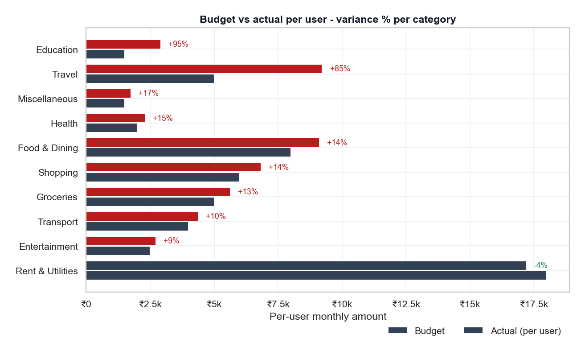 | 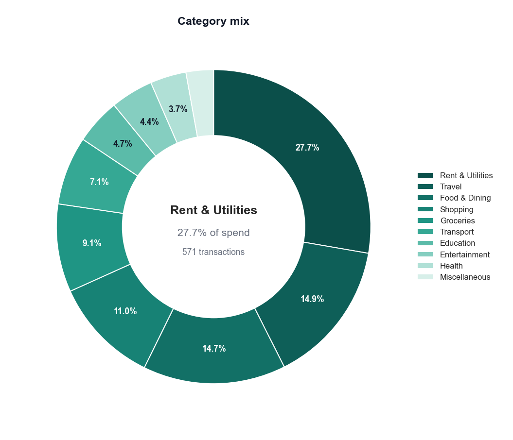 |
| **Budget vs actual per user** | **Category composition donut** |
| 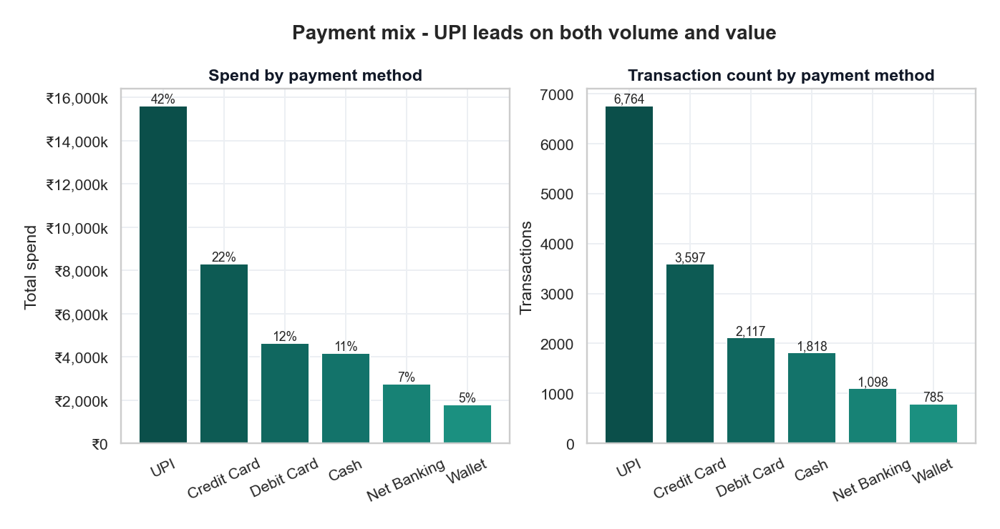 | 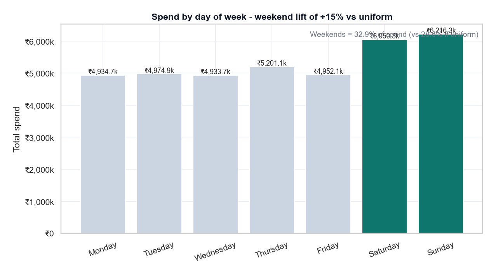 |
| **Payment method mix** | **Weekday × time-of-day spending heatmap** |
| 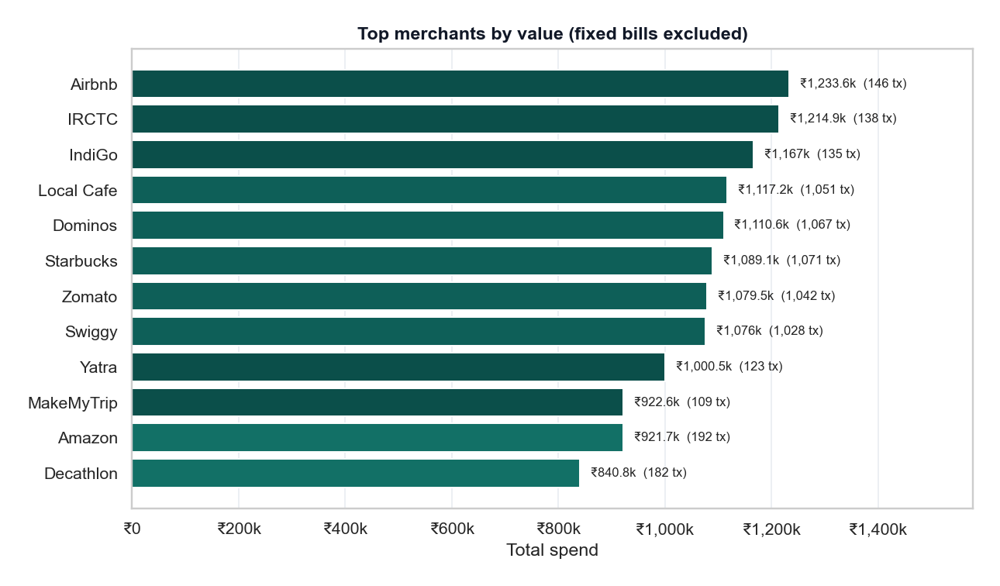 | 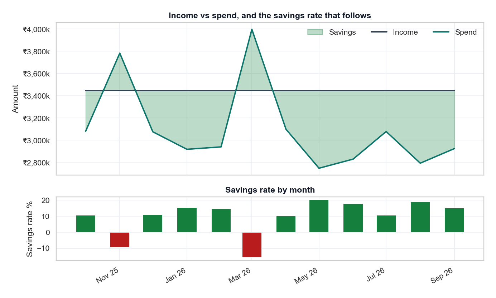 |
| **Top merchants by value and frequency** | **Savings rate by month** |
| 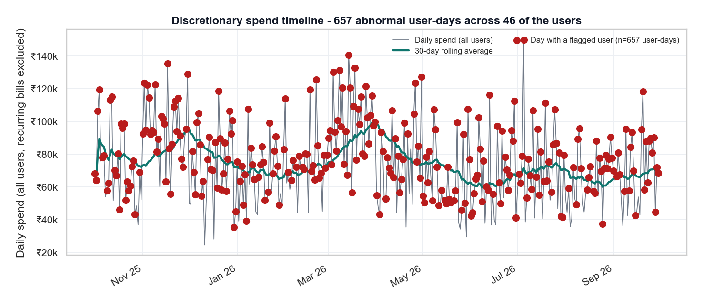 | 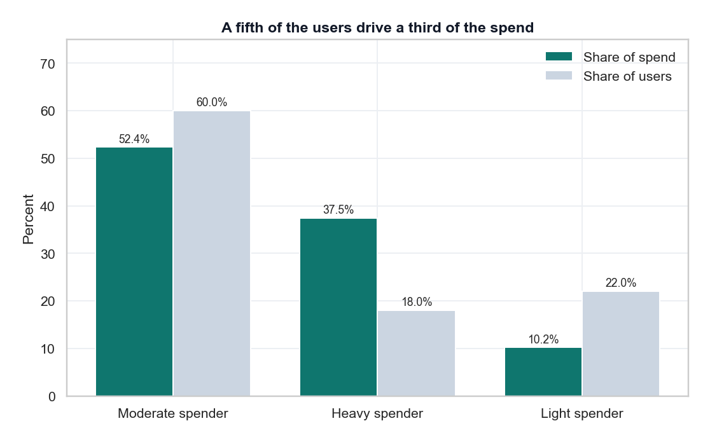 |
| **Discretionary spend timeline with flagged user-days** | **Spend by user segment** |

### Dashboard

> `python main.py dashboard`

| | |
| --- | --- |
| 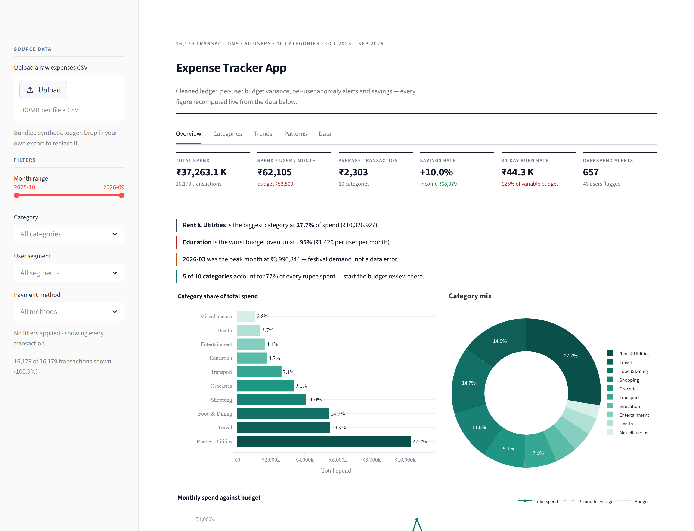 | 6-figure KPI row + written findings: total spend, spend/user/month vs budget, avg transaction, savings rate, 30-day burn rate, overspend alerts |
| 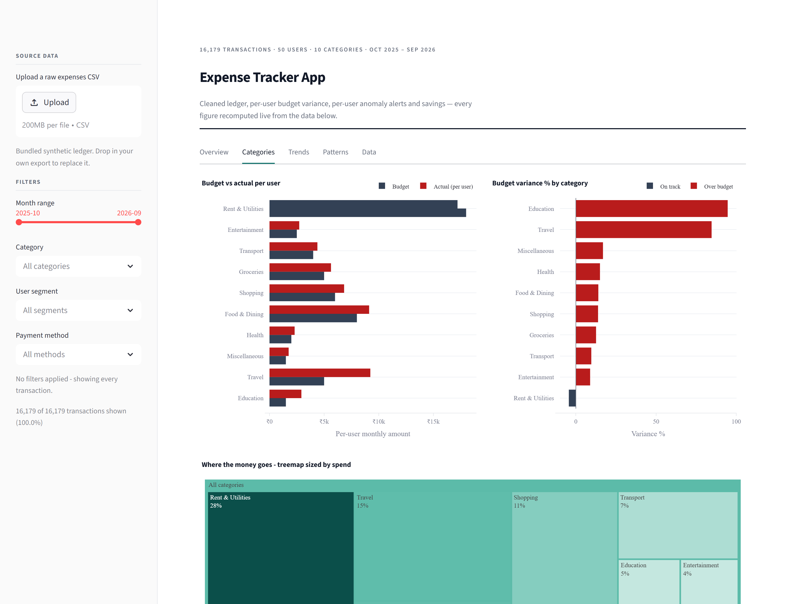 | Categories tab: share bars, budget variance, Pareto cut, merchant leaders per category |
| 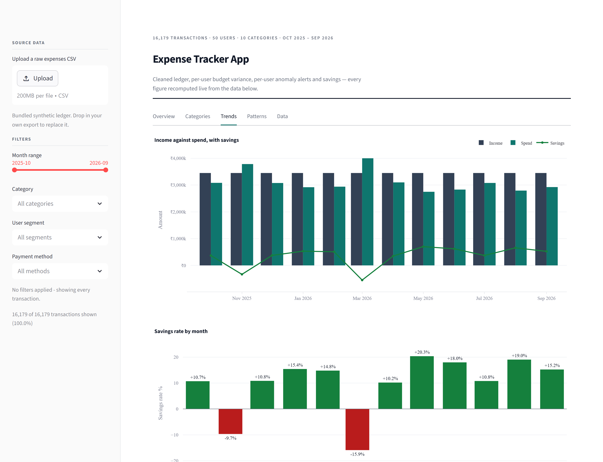 | Trends tab: monthly trend vs budget, savings rate, anomaly timeline, most extreme user-days |
| 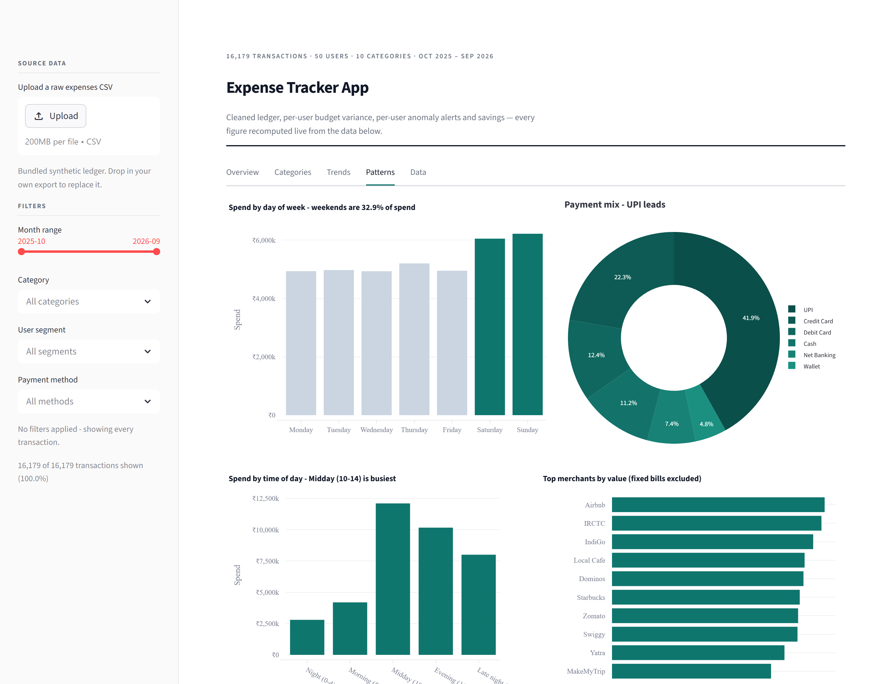 | Patterns tab: payment mix, weekday × time heatmap, merchant table, segment composition |

---

## 8. Dashboard walkthrough

| Tab | What to look for |
| --- | --- |
| **📈 Overview** | 6-figure KPI row, auto-written findings, category share bars, and the full category table |
| **🏷️ Categories** | budget vs actual per user with over/under status, the Pareto cut, and merchant leaders inside each category |
| **📅 Trends** | monthly spend vs budget, savings rate by month, the discretionary timeline with flagged user-days, and the most extreme user-days table |
| **🕒 Patterns** | payment-method mix, weekday × time-of-day heatmap, merchant ranking, and spend by user segment |
| **🗃️ Data** | cleaned transactions preview, largest single transactions, and **Download cleaned CSV** |

Sidebar controls: **upload your own expense CSV**, filter by category / user segment / date range, and toggle the month window.

---

## 9. Using your own data

The dashboard accepts any expense export. Required columns:

```text
user_id        date           amount         category
merchant (optional)   payment_method (optional)   income (optional, separate file)
```

Uploading runs the **same cleaning pipeline** on it, so the only requirement is a CSV — not a clean one. Unknown categories are mapped to `Miscellaneous` rather than dropped, because an expense that cannot be classified is still an expense.

```python
# or from Python
from src import data_cleaning
clean, quality = data_cleaning.clean_expenses(pd.read_csv("my_expenses.csv"))
```

---

## 10. Virtual simulation (how the data is made)

The generator is not random noise — it builds a *population with habits and a budget*:

1. **Sample 50 users** into heavy / moderate / light spender archetypes, each with a monthly income drawn around ₹68,000 (heavier spenders earn more).
2. **Give every user 10 category budgets** totalling ₹53,500/month, and a personal rent day between the 1st and 28th (so rent does not pile up on the same date for everyone).
3. **Sample transactions per category** from a monthly expected count, then scale by a **month factor** — November and March are festival months at ×1.45 — and by a per-user archetype multiplier.
4. **Bias the day of week.** Every category carries its own weekend probability (Entertainment and Food lean hard into weekends, Rent is weekday-only), so the weekend effect is a real signal rather than a chart with a claim attached.
5. **Assign merchant, hour bucket and payment method** from per-category distributions, so "Airbnb is the biggest merchant" and "UPI is the rail" emerge from the simulation rather than being asserted.
6. **Pollute it** the way a real export does: exact duplicates, `Rs. 1,299` text amounts, blanks, unknown categories, casing drift, zero/negative values, impossible outliers, future dates, and mixed date formats — **7,092 issues in total**.
7. **Run the pipeline on the result** — which is the point: cleaning, analysis and insights are all exercised by data with genuine structure and genuine defects.

Three bugs found and fixed *by* this simulation (see `docs/TROUBLESHOOTING.md`): `pd.to_datetime(format="mixed", dayfirst=True)` **silently reads ISO `2025-10-01` as 10 January**; comparing **aggregate** spend against **per-user** budgets reported every category as +5,000% over; and including rent in anomaly detection flagged every user on their rent day, which is why recurring bills are now excluded.

---

## 11. Testing

```bash
python tests/test_pipeline.py    # 25 tests, no pytest required
python -m pytest tests/ -q       # if you prefer pytest
```

| Test | Asserts |
| --- | --- |
| `test_config_is_coherent` | every category has a budget, merchants, a transaction range and a weekend weight |
| `test_generator_is_deterministic` | the same seed produces a byte-identical ledger |
| `test_generator_shape_and_window` | row/column shape, 50 users, the 12-month window |
| `test_raw_data_is_actually_dirty` | the 6 injected defect classes really exist in the raw file |
| `test_injected_counts_are_reproducible` | duplicate count equals `round(rate × rows)`, all dirt classes fire |
| `test_cleaning_removes_more_than_it_keeps` | 80% < retention < 100%, every removal counter is non-zero |
| `test_clean_has_no_duplicates` | no exact duplicate, and none behind formatting |
| `test_clean_has_no_missing_critical_values` | no NaN in id / user / date / category / amount / method |
| `test_clean_amounts_are_plausible` | all amounts positive, none above ₹100,000, dtype is float |
| `test_clean_dates_inside_window` | span inside the window, exactly 12 year-months (**guards the ISO date bug**) |
| `test_clean_categories_are_canonical` | every label is one of the 10 canonical categories |
| `test_category_shares_sum_to_100` | shares total 100%, totals reconcile with the cleaned file |
| `test_category_totals_match_the_raw_sum` | category spend sums to the ledger total, to the paisa |
| `test_budget_variance_arithmetic` | variance % equals `(actual − budget) / budget` exactly |
| `test_budget_is_compared_per_user_not_in_total` | variance is sane (**guards the +5,000% scaling bug**) |
| `test_monthly_summary_is_complete_and_consistent` | 12 months, ordered, savings = income − spend, rate matches |
| `test_pareto_never_exceeds_the_threshold` | the Pareto cut stops at the configured share |
| `test_anomalies_are_per_user_and_above_threshold` | every flagged day clears z, the rupee floor and beats its own median |
| `test_recurring_bills_are_excluded_from_anomalies` | rent can never be flagged (**guards the rent-day bug**) |
| `test_burn_rate_is_compared_to_the_variable_budget` | the burn-rate denominator excludes recurring bills |
| `test_merchant_share_claim_uses_the_right_denominator` | "of variable spend" must not be divided by total spend |
| `test_weekend_effect_is_measurable` | the promised weekend lift appears in the data |
| `test_all_charts_exist_and_are_non_empty` | 10 PNGs, each above 10 KB |
| `test_reports_exist_and_are_complete` | all 10 report sections, JSON has author/seed/totals |
| `test_reports_contain_no_unformatted_placeholders` | no `{placeholder}`, no leaked `nan` |
| `test_dashboard_runs` (AppTest) | the Streamlit app renders with **zero exceptions** |
| `test_dashboard_filters` (AppTest) | changing a sidebar filter re-renders cleanly |
| `test_browser_dashboard_end_to_end` (Playwright) | **17 real-browser checks**: every tab renders charts, filters apply and clear, the CSV upload path works, the download button exists, and there are **zero console/page errors** |

The browser test starts the dashboard itself, runs the checks, and tears the server down — so `python -m pytest tests/ -q` is the single command that proves the whole project works. Evidence screenshots land in `outputs/test_evidence/`.

---

## 12. GitHub upload

```bash
git branch -M main
git remote add origin https://github.com/harshaks17-ai/Expense-Tracker-App.git
git push -u origin main
```

- **Repo:** [`harshaks17-ai/Expense-Tracker-App`](https://github.com/harshaks17-ai/Expense-Tracker-App)
- **Description:** `End-to-end expense analysis pipeline: cleaning, budgeting, per-user anomaly detection, charts and an interactive Streamlit dashboard (Python, Pandas, Plotly).`
- **Topics:** `python` `pandas` `data-analysis` `data-visualization` `plotly` `streamlit` `matplotlib` `seaborn` `personal-finance` `budget-analysis` `anomaly-detection` `dashboard` `eda` `data-science`

Full step-by-step guide: [`docs/GITHUB_GUIDE.md`](docs/GITHUB_GUIDE.md)

---

## 13. Documentation

| File | Contents |
| --- | --- |
| [`docs/PROJECT_GUIDE.md`](docs/PROJECT_GUIDE.md) | Project explanation (simple + technical), tech-stack options A/B/C and why B was chosen, architecture, phase-wise plan with mistakes to avoid, day-wise proof-building plan, screenshot checklist |
| [`docs/INTERVIEW_PREP.md`](docs/INTERVIEW_PREP.md) | 12 interview questions with answers, HR + technical explanation |
| [`docs/GITHUB_GUIDE.md`](docs/GITHUB_GUIDE.md) | repo creation, commit hygiene, what to screenshot |
| [`docs/TROUBLESHOOTING.md`](docs/TROUBLESHOOTING.md) | every bug found while building this, and the fix |

---

## 14. Limitations (and what they mean)

- The dataset is **synthetic**; it demonstrates the pipeline, it does not describe any real person's finances.
- **Anomaly detection is univariate.** It compares a day to that user's own history; it does not know that a ₹22,000 transaction was a planned flight booking. A production alert would let the user tag one-off expenses as expected.
- **Budgets are fixed for all 12 months.** Real life has seasonal budgets — a single ₹5,000 travel budget cannot be right in both a festival month and a quiet one, which is exactly why the festival months blow past it.
- **Income is treated as a single monthly credit.** Bonuses, freelance income and variable pay are not modelled.
- **Category assignment is assumed correct.** In reality the hard part is classifying `AMZN*MKTP IN` into Shopping, and that problem is not solved here.
- Savings rate is computed on **income vs recorded spend** — unrecorded cash spending makes any tracker's savings rate look better than it is.

---

## 15. Future improvements

- [ ] Streamlit Cloud deploy or Docker image
- [ ] Power BI / Tableau version using the cleaned CSV
- [ ] **Recurring-bill detection** to separate fixed commitments from discretionary spend automatically
- [ ] Rolling seasonal budgets instead of one flat monthly budget per category
- [ ] Transaction-level classification model for unlabelled merchant strings
- [ ] Forecasting next month's spend per category (Prophet / simple seasonal model)
- [ ] Multi-user comparison and a "how do I compare to similar income" benchmark
- [ ] REST API (FastAPI) exposing the analysis endpoints
- [ ] Bank-CSV / UPI-statement importers for real data

---

## 16. License

[MIT](LICENSE) — free to use for learning, portfolios and coursework.

---

*Built as a portfolio project: cleaning → statistics → visualisation → insights → deployment. Synthetic data, real methods.*
